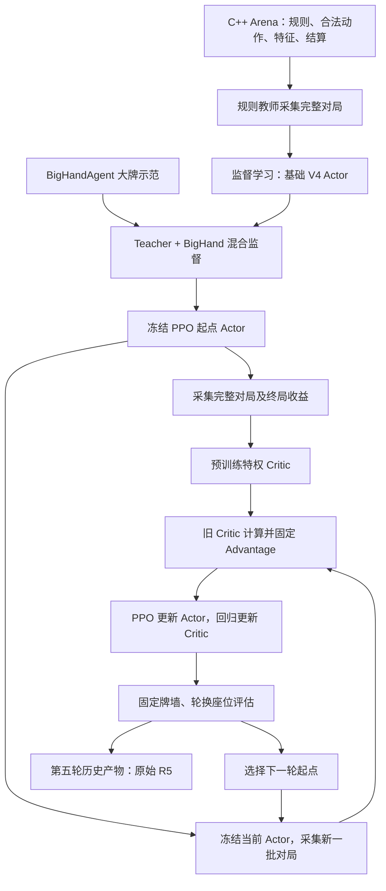

# R5 基础训练说明

本文介绍 GYMJ 的基础训练主线：模型从哪里来、使用什么数据、Actor 和 Critic 如何训练，以及如何评估。它不是历次实验的流水账，也不是所有功能都必须开启的一键配方。

## 1. R5 指什么

代码中的网络主要仍叫 `V4Actor`。最初的 R5 对应 V4 在混合监督预训练之后，完成第五轮 PPO 得到的 checkpoint，并不是名为 `R5Actor` 的另一套网络。

后续加入杠适配器、修正规则、继续 PPO、改进进张选择的模型，也在讨论中沿用了 R5 的称呼。因此，实验必须记录 **checkpoint 路径和 SHA256**，不能只记录“使用 R5”。

本文区分：

- **原始 R5**：第五轮 PPO 的历史产物。
- **R5 后续版本**：从这条训练路线继续演化的模型，可能使用不同规则、输入版本、奖励和 Critic。
- **当前网页模型**：部署配置指向的具体 checkpoint，不应默认等同于原始 R5。

历史冻结记录见 [v4_ppo_start_20260930.json](../experiments/v4_ppo_start_20260930.json)。其中包含当时的源码哈希、模型配置和训练参数。该文件的绝对路径是开发机历史记录，不是其他机器必须采用的目录。

## 2. 总体流程



基础训练不需要人类高手牌谱，也不需要 MCTS。规则教师提供起步能力，Arena 的实际结算提供强化学习目标。

## 3. 引擎、Actor、Critic 的分工

| 组件 | 输入 | 输出与职责 |
| --- | --- | --- |
| C++ Arena | 四家状态、牌墙、提交动作 | 判定合法性、推进牌局、计算最终四家收益 |
| 特征编码器 | 当前决策及允许观察的信息 | 向听、有效进张、牌型路线、公开历史、候选动作特征 |
| Actor | 本家手牌及公开信息 | 87 个动作的 logits，屏蔽非法及当前不支持的动作后选择 |
| 特权 Critic | 公开状态及训练时允许使用的隐藏状态 | 预测当前策略下的未来收益，辅助训练 Actor |

Actor 不读取对手暗手、真实牌墙或未来实际摸牌。引擎计算的公开牌理特征可以作为输入，但不能因为训练时有完整状态就把隐藏信息混进去。

V4 Actor 使用手牌/牌型编码、四家公开信息、全局与逐玩家弃牌历史、阶段信息，以及候选动作语义与牌理特征。融合状态后，按动作家族评分，最终仍输出 87 个 logits。它不是早期 V3 的“663 维输入加一个小残差分支”。

历史 V4 Critic 使用公开状态编码和特权状态编码，包括四家暗手、牌墙信息及假设顺序下的未来摸牌提示。后者会被碰杠改变，不是无条件成立的未来事实。基础版本分别预测净分和向听辅助回报；后来的四家零和 Critic 属于独立改进。

## 4. 阶段一：先学会规则教师的基本打法

使用 `ShantenTeacher` 采集完整对局。教师负责提供合法动作中的规则选择，Actor 学习模仿，不在这个阶段根据胜负进行 PPO 更新。

每个监督样本主要包括：

```text
决策前的公开特征
合法动作 mask
本次监督覆盖的动作 mask
教师认可的目标动作集合
所属牌局、玩家、决策类别
```

多个动作并列最优时，使用目标集合，不强迫网络只记住随机选中的一个。训练器使用集合目标的负对数似然；验证时预测落在目标集合内即可视为正确。

按牌局划分训练、验证、测试，不能把同一局的不同决策随机拆到不同集合。分别报告弃牌、碰/Pass、胡牌、报听表现，避免大量弃牌样本掩盖其他类别的缺口。

注意：采集器的 `--ready-policy` 默认是 `skip`。需要报听监督时应显式指定 `declare` 或设计相应数据，不能把“没有报听样本”当成网络已经学会报听。

入口：

- [采集教师示范](../python/gymj/collect_v4_demonstrations.py)
- [训练基础 Actor](../python/gymj/train_v4_behavior_clone.py)
- [分片监督数据集](../python/gymj/v4_demonstration_dataset.py)

## 5. 阶段二：混入大牌示范

`BigHandAgent` 单独产生七对、大对子、清一色路线示范。路线、成功与失败、最终分数用于审计和采样，不代表这些规则动作一定最优，也不直接把目标路线透露给 Actor。

混合监督的目的是让模型接触更多打法，同时保留基本出牌能力。它仍是行为克隆，不是只保留赢家，也不是 PPO。

历史 PPO 起点的实际混合训练配置：

| 项目 | 配置 |
| --- | --- |
| 初始模型 | 已补报听监督的基础 V4 |
| 本次使用的训练牌局 | Teacher 3500 + BigHand 1500 |
| batch | 128，分为 Teacher 90 + BigHand 38 |
| Teacher 采样比例 | 0.7 |
| 训练上限 | 20 epoch |
| 初始学习率 | 1e-4 |
| weight decay | 1e-4 |
| 大牌路线份额 | 七对 0.4、大对子 0.45、清一色 0.15 |

这里“5000”是这次混合训练选用的牌局数，不是说此前所有教师采集、基础训练、验证都只消耗了 5000 局。

入口：[大牌采集](../python/gymj/collect_v4_big_hand_demonstrations.py)、[构建训练视图](../python/gymj/prepare_v4_big_hand_training_view.py)、[混合监督训练](../python/gymj/train_v4_mixed_behavior_clone.py)。

## 6. 阶段三：准备 Critic

冻结 Actor，让它完成完整对局。每条状态记录关联所属玩家的终局净分，而不是把四个人的收益混在一起。

基础目标为：

```text
G_score   = 该玩家 Arena 终局净分 / 30
G_shanten = 从此时开始的未来弃牌向听奖励之和 / 10

V_score(s)   拟合 G_score
V_shanten(s) 拟合 G_shanten
```

除以 30、10 是尺度归一化，不改变 Arena 的实际计分规则。向听奖励来自弃牌前后向听差；胡牌、鸡、豆等最终实际收益由 Arena 结算，不能再重复加入一份胡牌奖金。

历史 Critic 预训练使用 5000 局，按 4000/500/500 划分训练/验证/测试，共 922289 条状态。训练上限 8 epoch，验证选中的最佳 epoch 为 2。其配置包括 batch 512、学习率 3e-4、公开编码器学习率 1e-4、向听 loss 权重 0.25。

Critic 学习的是**当前行为策略的期望收益**，不是完美玩家能赢多少，更不是某个动作的真实因果贡献。单局结果含有随机性，因此既要检查独立局面误差，也可以用固定局面重复续打均值辅助评估。

入口：[采集 Critic 数据](../python/gymj/collect_v4_critic_rollouts.py)、[训练 Critic](../python/gymj/train_v4_critic.py)、[网络结构](../python/gymj/v4_critic.py)。

## 7. 阶段四：分轮自博弈 PPO

每一轮执行以下步骤：

1. 冻结这一轮的 Actor，用它采集新的完整牌局。
2. 保存公开特征、特权状态、合法动作、实际选择、旧动作 log probability、玩家归属及回报。
3. 用更新前的 Critic 计算 Advantage，并在本轮训练中固定。
4. Actor 根据 Advantage 调整动作概率；Critic 根据回报修正预测。
5. 评估候选模型，决定下一轮从哪个 Actor/Critic 开始。

原始基础配方使用 Monte Carlo 回报，`gamma=1`：

```text
G = G_score + 0.25 * G_shanten
V = V_score + 0.25 * V_shanten
A = G - V
```

对可训练样本的 A 做标准化后用于 PPO。动作概率比值为 `exp(new_log_probability - old_log_probability)`，通过 clipped surrogate objective 限制单批更新幅度，并用熵项鼓励探索。Critic 用回归损失拟合回报。

虽然同一玩家的多个状态共享一个终局净分标签，各状态的 V 不同，所以 Advantage 不必相同。不过，这不等于精确知道“哪次碰牌贡献了多少分”。

历史冻结配方的主要参数如下；具体轮次若有调整，以该轮 manifest 为准：

| 项目 | 配置 |
| --- | --- |
| 每轮新对局 | 1000 |
| 采集 temperature | 1.0，随机策略采样 |
| 采集 worker | 12，每 worker 1 个 Torch 线程 |
| PPO epoch | 2 |
| batch size | 256 |
| Actor / Critic 学习率 | 均从 3e-5 线性降到 3e-6 |
| clip range | 0.2 |
| entropy coefficient | 0.01 |
| target KL | 0.015 |
| gradient clip | 1.0 |
| weight decay | 1e-4 |
| 向听回报及对应 value loss 权重 | 0.25 |

五轮各采集 1000 局，是原始 R5 的 PPO 阶段，不包含监督数据和 Critic 预训练数据。当前代码还支持 GAE、鸡分加成、碰杠 replay 辅助 loss，但这些不是原始五轮配方的一部分。

旧 Actor 产生的数据不能反复当作新 Actor 的 on-policy 数据。若使用固定对手，对手只提供环境行为，不能把对手样本误当成候选 Actor 自己采集的 PPO 样本。

入口：[采集 PPO 数据](../python/gymj/collect_v4_ppo_rollouts.py)、[数据结构](../python/gymj/v4_ppo_dataset.py)、[PPO 训练](../python/gymj/train_v4_ppo.py)。

## 8. 如何判断训练有效

基础固定评估包含两组：两个候选模型对两个冻结 V4，以及两个候选模型对两个 Teacher，每组 1000 局，轮换候选座位。它不是两个队伍合作，训练和收益仍按每个玩家分别计算。

历史协议从 seed 932000001 开始，在 167 副牌墙上展开 1000 场座位组合。因此 1000 场不是 1000 个独立牌墙。净分置信区间采用按牌墙聚类的 bootstrap，不能把这些座位变体当成完全独立样本。

检查每席净分及 95% 置信区间、胡牌率、放炮率、大牌率、碰杠报听频率，并同时检查 KL、clip fraction、entropy 和 Critic 误差。loss 下降或模型参数变化本身不代表牌力提高。

原始第五轮报告中，对冻结 V4 的每席净分为 +2.5355，对 Teacher 为 +2.4035；但相对第四轮的增量区间均跨零，不能宣称第五轮显著强于第四轮。该轮还存在 1328 次合法杠机会中实际杠为 0 的缺口。

这些数字来自历史规则和固定评估集，不能作为当前引擎、当前网页模型的最新性能证明。

入口：[固定对局评估](../python/gymj/evaluate_v4_matchups.py)。

## 9. 后续改进与基础主线的边界

| 后续工作 | 作用 | 是否属于原始 R5 基础训练 |
| --- | --- | --- |
| 杠脚本、杠适配器监督与联合 PPO | 补足原始策略缺少的杠行为 | 否 |
| 冲锋鸡等规则修正后重新采集 | 让训练与实际规则一致 | 否，但新训练必须使用正确规则 |
| 进张选择软标签微调 | 调整特定弃牌偏好，并保留原策略分布 | 否，是离线 Actor 训练 |
| 四家零和 Critic、Q Critic | 改进价值表示和动作价值估计 | 否 |
| 鸡分加成、碰杠反事实 replay | 增强特定决策的学习信号 | 否 |
| MCTS | 推理时搜索实验 | 否 |

进张微调详见 [effective_draw_distillation.md](effective_draw_distillation.md)。不要把该文档默认的 10% 标签混合与后来的 50% 实验混为一谈。

一个可核验的后续 R5 是 `r5-effective-draw-bc-alpha50-20261013/best_target_actor.pt`，SHA256 为 `9129dcc578c659e8fa84ceefa8248c213f8d5978965d45082fcce0c425158c6d`。它是目标 KL 选出的候选，不是通过原策略保持门槛的 `best_actor.pt`。这说明只看文件夹名或“best”字样不能确认实际使用了哪个模型。

## 10. 复现入口与发布注意事项

以下是一轮基础 MC PPO 的命令模板，**不是已验证的全流程一键复现**。在仓库根目录执行；先准备兼容的 C++ Python 扩展、依赖和 Actor/Critic checkpoint。`PYTHONPATH` 应指向当前构建对应的 Python 包，不要误用另一套旧扩展。

```powershell
$env:PYTHONPATH = Join-Path $PWD 'python'

# checkpoint 路径需替换成实际准备好的同版本模型。
$actor = './models/start_actor.pt'
$critic = './models/start_critic.pt'

python -m gymj.collect_v4_ppo_rollouts ./data/ppo_round_01 --actor $actor --rounds 1000 --seed-start 100000001 --policy-seed 1001 --temperature 1.0 --workers 12 --torch-threads 1 --device cpu

python -m gymj.train_v4_ppo --dataset ./data/ppo_round_01 --actor $actor --critic $critic --output ./models/ppo_round_01 --advantage-method mc --ppo-epochs 2 --batch-size 256 --actor-learning-rate 3e-5 --critic-learning-rate 3e-5 --final-lr-fraction 0.1 --shanten-weight 0.25 --shanten-value-loss-weight 0.25 --device cuda

python -m gymj.evaluate_v4_matchups --candidate ./models/ppo_round_01/actor_after.pt --baseline-v4 $actor --output ./evaluations/ppo_round_01 --games-per-matchup 1000 --seed-start 932000001 --workers 8
```

示例 seed 仅作模板，执行前应确认与本地训练/验证/测试集合不重叠。CPU 采集和 CUDA 梯度训练是两个独立选择，worker 数量需按机器容量调整。每轮使用新输出目录，并重新采集下一轮数据。

若做纯净分实验，采集端显式使用 `--no-shanten-reward`，训练端将 `--shanten-weight` 和 `--shanten-value-loss-weight` 设为 0。这是奖励配方变更，不是原始 R5 配方。

发布 GitHub 前还需完成以下独立工作：

- 保存可重建的代码版本、C++ 扩展构建方式和依赖环境；`requirements.txt` 的范围约束不等于完整锁定环境。
- 检查所需源码是否已经被 Git 跟踪，不能依赖开发机上的未跟踪脚本。
- 每轮记录 Actor/Critic 哈希、引擎与特征版本、seed、采样策略、奖励口径和参数。
- 如发布模型，提供可下载权重及校验值；不能仅保留开发机 `E:` 盘路径。
- 不上传 SSH 私钥、访问令牌或未经匿名化的人类玩家日志。
- 先用少量完整对局验证采集、训练、评估链路，再启动大批量训练。

本文只整理训练说明，不代表上述发布准备已经完成，也不代表当前工作区与历史冻结版本逐字一致。
